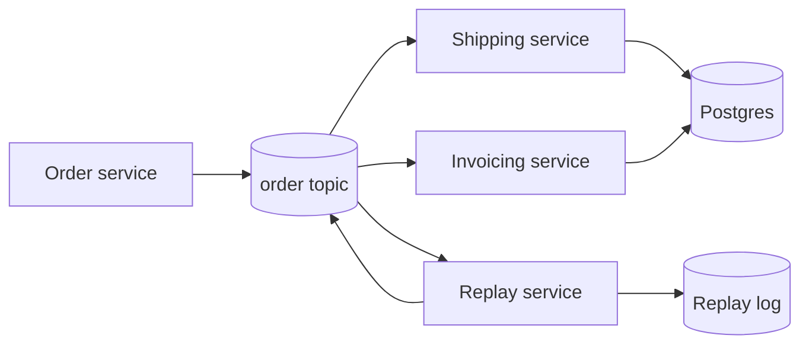
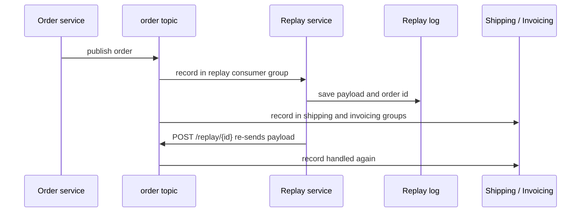

# Order Flow Replay

Replays the order topic into a dead-letter topic so failed shipments and invoices can be retried.



## Why

In an event-driven order flow, one record that a downstream service cannot handle means the shipment or the invoice for that order never appears, and nobody notices until a customer asks. Replaying by hand with a console consumer and a producer script is slow and easy to get wrong. Order Flow Replay keeps the failed records, shows them, and puts them back on the topic once the fix is in.

## How it works

The order service writes each new order to the `order` topic, which has 5 partitions. The shipping and invoicing services consume that topic in their own consumer groups and build a shipment or an invoice from each record. The replay service listens to the same topic in a third consumer group called `replay`. Its `ReplayService.record` method takes each record, reads the order id out of the payload with `OrderPayload.orderId`, and saves a `ReplayRecord` through `ReplayRecordRepository` into the replay service's own Postgres table, keeping the raw JSON exactly as it arrived. `ReplayController` lists those records at `GET /replay` and takes `POST /replay/{id}`; the controller calls `ReplayService.replay`, which loads the record, sends the stored payload back to the `order` topic with the same key the order service used so it lands on the same partition, then calls `markReplayed` to raise the replay count and stamp the time. Shipping and invoicing pick the record up again in their own groups.



## Key decisions

- The replay service uses its own consumer group instead of reading the shipping or invoicing offsets, so it sees every record without disturbing the services that do the real work. The cost is one more copy of each payload in Postgres.
- The stored payload is the raw JSON string, not a parsed order object, so a replay sends exactly what was published and the replay service does not need to track the order schema. The cost is that a payload cannot be edited before it is re-sent.
- The replay count is kept on the stored record, so a record that keeps failing is visible in the list instead of being replayed blindly. The cost is one extra write per replay.

## Tech stack

- Java 17 and Spring Boot 3.0.6
- Spring Kafka for the consumer and the producer
- Spring Data JPA on PostgreSQL
- Maven multi-module build
- Docker Compose for the whole stack, Apache httpd as the landing page

## Quick start

Prerequisites: JDK 17, Maven, Docker with Compose.

```bash
cd order-flow-replay
mvn package
cd ../docker
docker compose up --build
```

The landing page is at http://localhost:8080, the order service at http://localhost:8081, shipping at http://localhost:8082, invoicing at http://localhost:8083 and the replay service at http://localhost:8084.

| Variable | What it sets | Default |
| --- | --- | --- |
| `SPRING_KAFKA_BOOTSTRAP_SERVERS` | Kafka brokers the services connect to | `kafka:9092` in Compose |

## Usage

List the stored records:

```bash
curl http://localhost:8084/replay
```

```json
[
  {
    "id": 1,
    "orderId": 42,
    "seenAt": "2024-05-14T09:12:44.120+00:00",
    "replays": 0
  }
]
```

Replay one of them:

```bash
curl -X POST http://localhost:8084/replay/1
```

```json
{
  "id": 1,
  "orderId": 42,
  "seenAt": "2024-05-14T09:12:44.120+00:00",
  "replays": 1
}
```

## Project structure

```text
order-flow-replay/
  order-flow-replay-order/       order service, publishes to the order topic
  order-flow-replay-shipping/    shipping service, consumes the order topic
  order-flow-replay-invoicing/   invoicing service, consumes the order topic
  order-flow-replay-replay/      replay service, stores and re-sends records
docker/
  docker-compose.yml             kafka, postgres, apache and the four services
  apache/index.html              landing page with a link per service
```

## Limitations

- A replay re-sends the record as it was stored, so a payload that is wrong in itself has to be fixed upstream and published again.
- The replay log grows without a retention policy; old records are not pruned yet.
- The replay endpoint has no authentication, so it is meant for a local or trusted network.

## License

Apache-2.0. The project builds on [ewolff/microservice-kafka](https://github.com/ewolff/microservice-kafka), an Apache-2.0 sample of an event-driven order flow.
